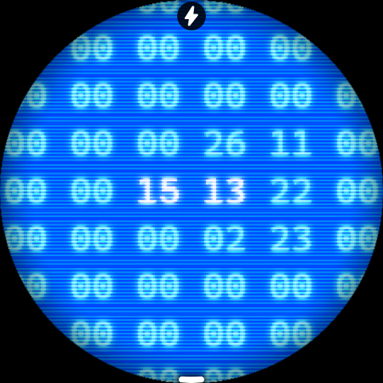

# CRT Watch Faces for Wear OS

Two retro CRT / hex-editor style watch faces built with the Watch Face Format.



## Features

- **Two variants:** **Blue CRT** (cyan on black) and **Green Hex** (green phosphor).
- **WFF only:** fully declarative Watch Face Format, no legacy `WallpaperService`. Built for Pixel Watch 4 / Wear OS 6+ (API 37).
- **Continuous CRT grid:** the whole face is a field of `00` tiles with scanline digits. Values use the original CRT number tiles, selected by BCD-encoded decimal pairs, so the scanline pattern stays aligned across the entire display.
- **Readouts:** centered `HH MM SS`, date as `00 YY / DD MM`, plus right-aligned heart rate, battery and steps in fixed two-digit cells.
- **Motion warp:** moving the watch quickly toward you zooms the whole face in; moving it away zooms out. Driven by the accelerometer through eased WFF `Transform` animations (0.7s), with a motion gate that always returns the face to its 1.15× resting scale.
- **Responsive vignette:** a fixed vignette keeps the CRT edge smooth during zoom, and a second layer darkens the corners only when zooming out.
- **Ambient mode:** decorative tiles are hidden for lower power use and reduced burn-in.

## Build

```sh
./gradlew :wff:assembleDebug
./gradlew :wffgreen:assembleDebug
```

The APKs are written to `wff/build/outputs/apk/debug/` and `wffgreen/build/outputs/apk/debug/`.

## Customizing

The scene XML for both faces is generated from `wff/gen-decimal.ps1`. Edit that script and regenerate:

```powershell
powershell -File wff/gen-decimal.ps1 -OutFile wff/src/main/res/raw/watchface.xml -Theme blue
powershell -File wff/gen-decimal.ps1 -OutFile wffgreen/src/main/res/raw/watchface.xml -Theme green
```
